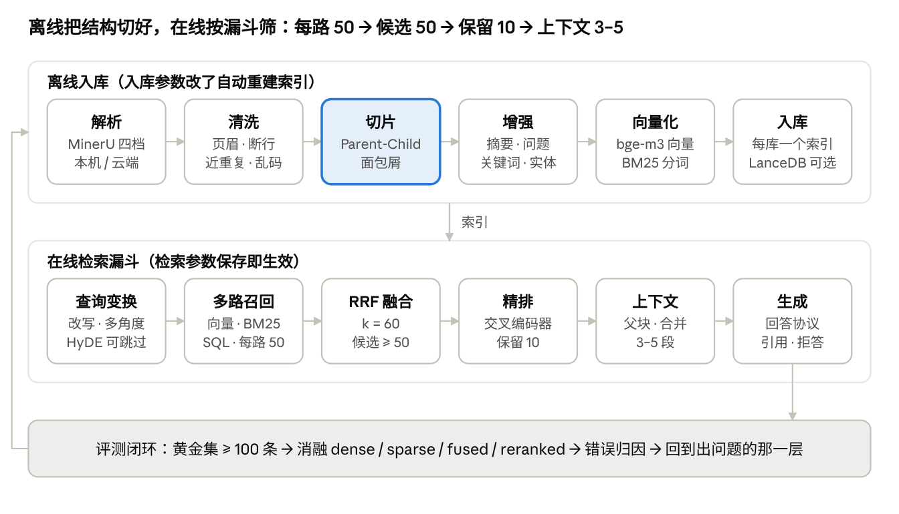
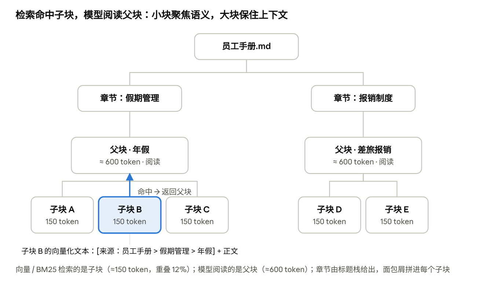
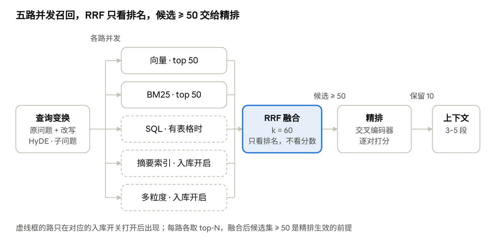

# RAG Agent Studio 优化手册

> 2026-10-12 整理。可协作编辑的在线版本：https://claude.ai/code/artifact/31c60343-ac03-42d8-971e-8f6a777aa035 
> 每一节的结构：这一层解决什么 → 本项目的开关与参数（`config.yaml` 路径）→ 推荐值与依据 → 代码位置。

## 导读：先找对层，再调参数

效果问题先定位发生在哪一层，再动参数；不要一出问题就换大模型。本手册每一节按同一结构写：这一层解决什么 → 本项目的开关与参数（`config.yaml` 路径，策略配置页可覆盖）→ 推荐值与依据 → 代码位置。

检索质量是四个因子的乘积，短板拖全盘：把一个维度从 0.6 调到 0.9，不如四个都从 0.5 调到 0.7。

$$
\text{检索质量} \approx \text{切块质量} \times \text{检索策略} \times \text{排序质量} \times \text{Query 质量}
$$

上排是离线入库，任何一步的参数改了都要重建索引；下排是每次提问走的漏斗，改了立即生效。评测的错误归因决定回到哪一层改。

**调优顺序与时间分配**（一次只改一个变量，每次改完跑一遍评测集，指标不动不合入）：

1. 切块（50%）：最前置，改完不动下游；先把 Top-3 命中率从 60% 拉到 80%
2. 混合检索（20%）：补专有名词、编码、错误码
3. 重排（20%）：Top-3 再拉 10 个点；候选数不能低于 50
4. 查询改写（10%）：检索合格后再做，唯一从前端入手的手段

**漏斗参数**（`retrieval.*`，默认值即推荐起点）：

| 环节 | 参数 | 默认 | 说明 |
| --- | --- | --- | --- |
| 每路召回 | `top_n_per_route` | 50 | 50–100，比最终 top-K 大 5–10 倍 |
| 融合后候选 | `rerank.candidates` | 50 | 传给重排器的候选数，低于 50 效果断崖式下跌 |
| 重排保留 | `rerank.keep_n` | 10 |  |
| 最终上下文 | `rerank.top_k` | 5 | 3–5，Lost in the Middle |
| 上下文预算 | `granularity.max_context_tokens` | 3000 |  |

**配置在哪里改**：`config.yaml` 是基线；前端「策略配置」页保存的覆盖值存在 SQLite（`app_settings.settings_overrides`），优先于基线；「检索实验室」可按单次请求覆盖参数而不保存。解析 / 清洗 / 切片 / 索引增强 / 向量库建库参数属于入库期参数，保存后系统自动在后台重建受影响知识库的索引（`app/services/reindex_service.py::ingest_fingerprint`）；检索期参数保存即生效。

## 文档解析：结构没解析出来，后面全是补救

解析决定切片能拿到什么结构：标题层级、表格、图注、页眉页脚是否被打标。Markdown 永远直解析，Excel / CSV 永远走行级结构化，其余格式优先 MinerU，MinerU 不可用时自动降级到内置解析器（pdfplumber / python-docx / python-pptx）。

**按格式选解析路径**（`prism/ingest/parsers/__init__.py::ParserRegistry`）：

| 格式 | 路径 | 原因 |
| --- | --- | --- |
| Markdown | Markdown 解析器（`parsing.markdown_first: true`，不可关） | 标题层级天然给出章节结构；代码块 / 表格是显式原子块 |
| 数字 PDF、Word、PPT、EPUB、OFD、HTML | MinerU `flash` | 不跑推理模型，建索引最快；Office 由 DocVortex 原生解析，不转 PDF |
| 扫描件、普通表格、公式 | MinerU `basic` | ONNX 小模型做 OCR / 公式 / 表格，纯 CPU 可跑，模型包约 0.8 GB |
| 复杂版面（多栏、图文混排、跨栏表格） | MinerU `standard` / `advanced` | 小模型 + VLM，模型约 2 GB，内存 ≥ 8 GB |
| Excel / CSV | 行级结构化块（每行一块，附表名与列名），同时入 SQL 路 | 查表格本质是查数据库，整表压扁后检索到的是碎片 |
| 图片 / 图表 | MinerU `image_analysis: true` 生成描述，再进多模态管线 | 图片要先变成文字才能被检索 |

**MinerU 在哪里跑**（`parsing.mineru.mode`，策略配置 → 文档解析 →「解析方式」）：

| 方式 | 适合 | 代价 |
| --- | --- | --- |
| `local` 本机 | 有 GPU 或内存够的机器；涉密文档 | 要下载模型包；standard 档吃 8 GB 内存 |
| `cloud` 云端 API（mineru.net） | 内存小、没有 GPU，又要 standard 质量 | 文档上传到第三方；目前只提供 standard 档，选了别的档位自动改用；匿名调用单文件 ≤ 200 页 |
| `server` 自托管 `mineru-kit api-server` | 多台应用机共用一台 GPU 解析机 | 自己维护服务 |

阿里云 2 核 4 GB 的部署机上，`flash` / `basic` 本机可用；需要 standard 质量时切云端 API。云端或服务连不上时，有内置解析器的格式自动降级，并在文档元数据 `extra.mineru_error` 里记录原因。

**真实 PDF 上踩过的坑**（mineru 4.0.10，4 页浏览器导出的中文 PDF）：

- `flash` + `ocr_mode: auto` 遇到私用区图标字形会改走 OCR：空心圆点被认成「。」、emoji 丢失；`ocr_mode: txt` 直接读文本层，0.1 秒，保留 emoji。扫描件以外先试 `txt`
- 文本层里的「音 手 一」是康熙部首码位（⾳ ⼿ ⼀），不归一化则「语音」检索不到「语⾳」；接入层已统一归一化为通用汉字
- 课程大纲整块被标成 `index`（目录）：按列表保留而不是丢弃，否则整页内容消失
- 首页标题被标成 `header`：只出现一次的页眉当正文保留
- 连续的纯标题并入后一节，避免主标题、副标题从索引里消失

**MinerU-Popo 文档树**（`parsing.popo.enabled`，默认关）：MinerU 是页面级解析，页边界会切断段落、劈开表格、丢失标题层级。Popo 用 4B 模型做后处理，把 MinerU 的层级 TEDS 从 53.7 提到 90.6。收益是跨页表格合并成一张、被分页打断的段落续接后再切片、标题层级来自全文所以面包屑更准。需要 GPU 跑推理：知识库页对 PDF 点「Popo」→ 导出输入 → `scripts/run_popo.sh` → 打开开关 → 对文档「重新解析」。只要标题分级 / 跨页表格续接时，MinerU 4.0 内置的 `llm_aided` 后处理更轻。

代码：`prism/ingest/parsers/mineru_parser.py`（本机 SDK / 远程 v1 协议、Content List → Block）、`mineru_tiers.py`（档位状态、远程档位探测、连接测试）、`popo_bridge.py`、`html_table.py`（HTML 表格 → Markdown，处理 rowspan / colspan）。

## 内容清洗：对全文做，不要对单块做

清洗在切片之前、解析之后，因为页眉页脚和重复段落只有看全文才认得出来。所有开关在 `cleaning.*`，默认全开；改了触发重建索引。

| 问题 | 表现 | 做法 | 参数 |
| --- | --- | --- | --- |
| 页眉 / 页脚 / 页码 / 水印 | 每页重复的公司名、「第 x 页」，占位还稀释向量 | MinerU 已打标（header / footer / page\_number）的直接丢；未打标的按「同一行出现在 ≥ 40% 页面」识别 | `drop_headers_footers: true`、`header_footer_min_page_ratio: 0.4` |
| PDF 断行 | 一行一个换行，切块得到大量半截句 | 上一行不以终止标点结尾且下一行不是列表项 → 拼接；中文直接拼，英文补空格，连字符断词去连字符 | `fix_pdf_linebreaks: true` |
| 乱码 / 不可打印字符 | 扫描件 OCR 噪音 | 非法字符占比超阈值的块丢弃；NFC 归一化（不用 NFKC，它会改掉中文标点） | `garbled_ratio_threshold: 0.3` |
| 重复内容 | 同一段落多处出现，权重虚高，top-K 被同一段占满 | 精确哈希去重 + 字符 5-gram Jaccard 近似去重 | `dedup_near_duplicates: true`、`dedup_jaccard_threshold: 0.9` |
| 碎块 | 只有一两个字的块 | 丢弃 | `min_block_chars: 2` |

两个阈值怎么调：

- `header_footer_min_page_ratio` 调低会把章节标题误判为页眉（长章节的标题在运行头里重复出现）；页数少于 5 页的文档比例没有意义，靠 MinerU 的打标
- `dedup_jaccard_threshold` 调到 0.8 以下会把「同一条规则的新旧版本」当重复删掉，新旧版本的区分要靠元数据和时效过滤，不要靠去重

「内容精简」（去营销话术、免责声明）没有自动化：知识库页的「校对」可以直接改 Markdown 回灌（解析器标记为 `+edited`），重新解析时校对稿优先于原文件。

代码：`prism/ingest/cleaning.py`（`clean_document` / `fix_linebreaks` / `drop_repeated_page_lines` / `dedup_blocks`）；质量体检的阈值在 `corpus.near_dup_threshold: 0.85` 与 `corpus.garbled_threshold: 0.15`（只报告、不改数据，语料治理页）。

## 语义感知切片与 Parent-Child：检索用小块，阅读用大块

切片是投入产出比最高的一层：同一个向量模型下，固定 500 字换语义切块 Top-3 命中率 61% → 82%，而换更强的 embedding 只涨 3 个点。真正要回答的问题不是「chunk size 设多少」，而是「用户的一个问题通常需要多大的知识单元才能被完整回答」。

子块 B 被向量或 BM25 命中后，返回给模型的是它所属的「年假」父块；同一父块内多个子块命中时合并为一段。

**三种策略**（`chunking.strategy`）：

| 策略 | 做法 | 适合 | 代价 |
| --- | --- | --- | --- |
| `structural`（默认） | 按标题栈 → 章节 → 段落，给每块拼面包屑 | 制度、手册、技术文档：凡是解析器给得出层级的 | 没有标题的流水账退化为段落切 |
| `semantic` | 相邻句 embedding 距离超过 P80 处下刀 | 主题切换明显、但没有标题的长文 | 建库多一次 embedding（离线可忽略） |
| `recursive` | 段落 → 句 → 字符 | 一般叙述文本（公告、新闻稿） | 语义边界不保证 |

**粒度参数**（中文 1 token ≈ 1.5 字）：

| 参数 | 默认 | 推荐 | 为什么 |
| --- | --- | --- | --- |
| `parent_max_tokens` | 600 | 500–800 | 阅读粒度：规则和它的例外要在同一块（「住宿标准 600 元 … 部门负责人可审批上浮 20%」） |
| `parent_min_tokens` | 120 |  | 太短的章节并入相邻 |
| `child_tokens` | 150 | 100–150 | 检索粒度：向量语义聚焦 |
| `child_overlap_ratio` | 0.12 | 10%–15% | 太大重复检索、浪费 token |
| `respect_atomic_blocks` | true | 不要关 | 表格 / 代码 / 公式不拆 |
| `table_row_split_tokens` | 800 |  | 超长表格按行拆，每块重复表头 |
| `semantic_breakpoint_percentile` | 80 |  | 调低切得更碎 |

**面包屑是必做项**。「该费用不予退还」——哪个费用？答案在两页之前。结构切片给每块拼上 `[来源：员工手册 > 假期管理 > 年假]` 再向量化，块里没有「年假」两个字标题也能补上语义信号。`Chunk.embed_text()` = 面包屑 + 上下文摘要 + 假设性问题 + 关键词 + 正文。

**Parent-Child 在检索期怎么用**（`retrieval.granularity.*`）：向量 / BM25 命中的是 child，`return_parents: true` 返回所属 parent；`auto_merge_adjacent: true` 把同一 parent 内多个相邻命中合并；`sentence_window`（默认 0）以命中 child 为中心向前后扩展 N 个。

**多粒度分层索引**（`chunking.multi_granularity`，默认关）：在 parent / child 之外再建「章节级」（`section_max_tokens: 1500`，按 `section_depth: 1` 级标题归并）与「句子级」两层；检索时 `retrieval.hierarchy.routing: auto` 按问题类型选层——概念 / 概述类问题加章节路，细节 / 数值类问题加句子路。库里长章节多、问题既有「总结一下假期制度」也有「年假几天」时才值得开。

进阶：Late Chunking（先对长段落 embed 再在语义边界切，jina-embeddings-v3 支持，长篇技术文档再涨 3–5 个点）本项目未实现。

代码：`prism/ingest/chunking/structural.py`、`semantic.py`、`recursive.py`、`parent_child.py`；前端知识库页「切片预览」可在入库前看切出来的父子块。

## 元数据与权限过滤：先把范围缩小，再算相似度

向量相似度分不清「话题对、但年份 / 部门 / 类型不对」的文档：问「2024 版的住宿标准」，2026 版手册里的同一节在语义上一样近。元数据过滤在召回之前按文档属性把候选圈小，范围外的块不参与任何一路召回——是前置过滤，不是取 Top-K 再筛。

**文档的「身份证」**（`schemas.DocMetadata`，知识库页可编辑）：标题、版本、生效 / 失效日期、部门、标签、密级、允许查看的部门。`corpus.auto_metadata: true` 在上传解析后用规则自动抽取，只填空字段；`auto_metadata_llm: true` 再让文本模型补规则没找到的，结果要能在原文里找到依据。Markdown 文件的 front matter 直接读入。

**四种过滤，层层叠加**：

| 过滤 | 依据 | 开关 | 行为 |
| --- | --- | --- | --- |
| 权限 | 顶栏「当前身份」的级别 + 部门 vs 文档密级 / 允许部门 | `retrieval.access.enabled: true` | 检索层强制，不依赖模型拒答；实体织入的块同样过滤 |
| 时效 | `valid_from` / `valid_to` | `retrieval.filter_expired: true` | 过期文档不召回 |
| 历史意图 | 问题里的「2024 版」「旧版」「去年」 | `retrieval.history_intent: true` | 放行过期语料，资料里标注「已失效」，由回答说明时效 |
| 自查询 | 从问题里读出年份 / 部门 / 标签 / 文件类型 | `retrieval.metadata_filter.mode: llm` | 辅助模型只在本库真实存在的取值里挑，输出再校验一遍 |

**自查询的三道保险**（识别结果是推测）：

1. 条件不缩小范围就不生效
2. `include_missing: true`：没填该属性的文档不排除——标签通常填不全，排除会把没打标的文档整批丢掉
3. `fallback: true`：按条件查不到任何结果时去掉条件重查一次，并在链路说明里写明

实测（示例库 6 篇文档，bge-m3 + bge-reranker-v2-m3，条件识别用 deepseek-flash）：36 个无范围限定的问题在 `off` / `rule` / `llm` 下 Hit@1 / Hit@5 / MRR 都是 0.972，没有误伤；「2024 版员工手册里出差住宿标准」在 `off` 时上下文新旧混杂，`llm` 同时识别出年份和「差旅」标签后只剩 2024 版；开着查询变换时耗时无可见差别（模型调用与查询变换并行）。

**什么时候会帮倒忙**：标签打得不全或太细（条件「标签=售后」会排除打了别的标签但也讲售后的文档）→ 从 `fields` 里去掉 `tags` 或改 `rule`；部门是「谁发布的」不是「讲的是谁」，「财务部的报销流程」答案可能在人力部发布的手册里。

**向量库层面的预过滤**：numpy 先按掩码筛再算相似度；LanceDB / Qdrant 允许的块 ≤ 5000 个时把条件下推，更多时多取再筛、不够就加倍重取；Chroma 只能多取再筛。「固定取 4 倍再筛」会出现库里有却一条搜不到，已改掉。

代码：`prism/retrieval/metadata_filter.py`、`prism/index/doc_store.py::filter_child_ids`、`prism/retrieval/retriever.py`；手动条件走检索实验室「限定范围」或接口 `filters`，可选项 `GET /api/v1/retrieval/<kb_id>/facets`。

## 索引增强：在入库期花钱，换检索期的命中

索引增强都是在入库时给每块补上「它在整篇里讲什么」或「用户会怎么问它」，代价是每块一次 LLM 调用，所以默认全关；先把双路召回 + 重排做稳，再用评测决定开哪一项。除关键词外都需要文本模型（用 `generation.llm.aux_model` 指定的快模型），没有模型时自动退化或跳过。

| 手段 | 开关 | 做法 | 解决什么 | 依据 / 代价 |
| --- | --- | --- | --- | --- |
| 上下文摘要（Contextual Retrieval） | `enrich.contextual_summary` | 为每块生成「这段在整篇里讲什么」，拼进向量化文本 | 孤儿 chunk：面包屑还不够时 | arXiv 2604.01733：Recall@5 +2.8pp；每块一次调用 |
| 假设性问题（反向 HyDE） | `enrich.hypothetical_questions`、`questions_per_chunk: 3` | 为每个 parent 生成 N 个用户可能问的问题，与正文一起索引 | 「问题 ↔ 文档」两种文体的向量距离 | FAQ 类库收益最大 |
| 摘要索引 | `enrich.summary_index`、`summary_max_chars: 200` | 每个 parent 一条摘要，单独建一路召回（`retrieval.summary.weight: 1.0`），命中返回原文 | 长段落语义稀释 | 无 LLM 退化为标题 + 首句 |
| 关键词 | `corpus.keywords`、`keywords_per_chunk: 8` | TF-IDF + 编号保护抽 8 个关键词，写进向量与 BM25 文本 | 索引降噪 | 不需要 LLM |
| 多粒度辅助索引 | `chunking.multi_granularity` | 章节级 + 句子级两层，按问题类型选路 | 概述问题与细节问题共存 | 见切片一节 |
| 实体图谱（UnWeaver） | `retrieval.graph.llm_extraction` | 用 LLM 抽取（实体, 关系, 实体）三元组；关闭时只用规则抽「术语 → 定义」 | 提到术语但定义在别处 | LLM 抽的实体很密，检索期要配合 `weave_relevance` 门槛 |

**哪些被算进向量**：`Chunk.embed_text()` = 面包屑 + 上下文摘要 + 假设性问题 + 关键词 + 正文；BM25 文本同样含关键词。这些增强都进入入库指纹，开关一改全库重建；`enrich.max_concurrency: 4` 控制重建时的并发调用数。

**成本估算**：一个 2000 块的库，开上下文摘要 + 假设性问题 = 4000 次辅助模型调用，每次改切片参数都要重来。先在一个小库上用评测中心的消融确认收益再全量开。

代码：`prism/ingest/enrich.py`、`prism/corpus/keywords.py`、`prism/graph/unweaver.py`。

## 语料增强：先知道用户会问什么，再补库里答不好的

语料问题在检索层调不好：知识缺失时任何一路都召不回，过期文档和新版同时在库时系统在两份之间反复横跳。语料增强从「意图空间 vs 知识空间」出发：收集真实提问，跑一遍检索，找出答不好的，补知识或下线无关材料。

**覆盖度分析**（前端「语料覆盖」页 / `rag coverage intents.txt`）：每行一个真实问题（工单、搜索日志、群聊、销售 FAQ），建议 ≥ 100 条，常见 50% / 长尾 30% / 多跳 20%。每条跑一次真实检索（关闭查询改写，看的是语料本身）：

| 信号 | 含义 |
| --- | --- |
| `term_coverage` | 意图关键词在最优上下文中的覆盖率，按语料 IDF 加权；语料里从未出现的词权重最高，精确 token 加倍，「能不能 / 多少 / 怎么」不计 |
| `dense_sim` | 向量路 top-1 余弦相似度 |
| `rerank_score` | 交叉编码器 / Rerank API / LLM 精排的 top-1 相关度（只有这三类是绝对分数） |

匹配分 = 有绝对精排分时 0.6 × rerank + 0.4 × term\_coverage，否则 0.7 × term\_coverage + 0.3 × min(1, dense\_sim / 0.5)。≥ 0.6 高匹配、≥ 0.35 部分匹配、其余无匹配；列出缺失关键词就是知识缺口。反查知识空间：每份文档被多少条意图命中 → 核心语料（≥ 3）/ 辅助语料 / 未被命中（确认后移出）/ 已过期；「只被过期版本覆盖」单独提示——这不是没有知识，是知识没更新。

**四种处置**：

| 区间 | 处置 | 本项目工具 |
| --- | --- | --- |
| 高匹配 | 标注答案后直接沉淀为黄金评测集 | 评测中心 |
| 部分匹配 | 补章节、更新版本、导出结构化表格 | 知识库页校对 / 重新上传 |
| 无匹配 | 列入知识补充计划，同时配置拒答话术 | 语料增强（下） |
| 无关 | 移出语料，避免噪音与权重虚高 | 语料治理页「剔除清单」 |

**FAQ 增强语料**（`prism/corpus/augment.py`）：从「用户会问、但库里答不好」的问题出发，用文本模型根据现有资料草拟答案（资料里没有的输出 `NO_ANSWER`），**人工审核后**生成一份 FAQ 文档入库（解析器标记 `augment`，标签「增强语料」）。FAQ 块的面包屑末级就是问题本身，所以对同义问法的命中最直接。

**别名词典**（`prism/corpus/aliases.py`，知识库级，存应用数据库）：缩写 ↔ 全称、产品代号 ↔ 正式名、口语 ↔ 书面语；查询时扩展、入库时补进 BM25 文本。语料治理页会从语料与历史问题里推荐候选别名。这是 BM25 路解决「退货 vs 申请售后」词不重叠的唯一办法。

**质量体检**（`prism/corpus/health.py`）：近似重复（`corpus.near_dup_threshold: 0.85`）、乱码占比（`garbled_threshold: 0.15`）、过短 / 过长块、没有面包屑的孤儿块、过期但仍在库的文档。只报告不改数据。

**Agent 湖回流**（`lake.augment: true`）：每轮问答自动沉淀问题 + 检索日志 + 回答 + 反馈；回答时召回余弦相似度 ≥ 0.75 的历史问答（只取未被点踩、非拒答的）作参考上下文，不编号、不可引用。检索最高分低于 `lake.low_score: 0.05` 的问题记为低置信，就是下一轮覆盖度分析的输入。

代码：`prism/eval/coverage.py`（`CoverageAnalyzer`）、`POST /api/v1/eval/{kb_id}/coverage`、`prism/corpus/*`、前端 `coverage.tsx` / `governance.tsx`。

## 查询层优化：用户怎么问 ≠ 系统应该怎么搜

查询层是唯一从前端入手的手段，也是最后才调的：检索合格之前改写只会把错误搞得更难归因。所有开关在 `retrieval.query_transform.*`，由辅助模型执行，各项并发；无模型时返回原问题。

| 方法 | 开关 | 默认 | 解决什么 | 注意 |
| --- | --- | --- | --- | --- |
| 多轮归并 | `condense_history` | 开 | 追问里的「它 / 那个」 | 结合历史改写成独立问题，再进其他变换 |
| 改写 / 压缩 | `rewrite` | 开 | 口语、指代不清、噪音词稀释向量：「那啥我想问一下…租办公室的钱报销政策」→「办公室租金 报销政策」 | 案例里 Top-3 91% → 94% |
| Multi-Query | `multi_query: 3` | 3 | 提问角度与文档描述角度对不上 | 3–5 条，覆盖率 +10–15%；`keep_original: true` 原问题必须保留 |
| 子问题分解 | `decompose` | 开 | 「通讯补贴和交通补贴有什么不同」→ 两个子问题分别检索 | 多跳问题的轻量版 |
| HyDE | `hyde`、`hyde_max_query_chars: 30` | 开 | 问题与文档文体不同、短 query 语义锚点不足 | 只对 ≤ 30 字的 query；temperature 0；短 query 零样本 +15–25% |
| Step-back | `step_back` | 关 | 问题太具体、库里只有通用背景 | 先抽象成背景问题 |

**HyDE 的两个反模式**（`skip_hyde_on_precise_tokens: true` 自动避开）：

1. 数值 / 精确查询：「2024 年 Q3 财报净利润」——LLM 编的「净利润同比增长 23.5%」会把检索拉向讨论增长率的文档；arXiv 2604.01733 明确 HyDE 对数值查询有害
2. 需要精确元数据匹配：「作者是张三的合同」——用元数据过滤

决策规则：query 含精确数字、人名、编码、型号、日期 → 跳过 HyDE，直接双路 RRF。`has_precise_tokens` 用 BM25 存储里同一个 `PRECISE_TOKEN` 正则，两处判断一致。

**路由**（`retrieval.router`，默认关）：多知识库时按库名称 + 描述 + 类别的向量相似度（`mode: embedding`）或 LLM（`mode: llm`）选 `top_kbs` 个库。库的描述写得越像用户的问法，路由越准。

**跨语言**（`multimodal.cross_lingual: true`）：中文问英文图表时用辅助模型把问题译成图片文字的语言补充检索（每问题一次调用，有缓存）。CLIP 论文实测文搜图 hit@1 0.65 → 0.77。

**辅助模型**（`generation.llm.aux_model`）：改写 / HyDE / 分解 / text-to-SQL / 路由 / 元数据条件识别都走它，选快模型（deepseek-flash、claude-haiku-4-5），`aux_effort: low`，关思考。必须在回答模型的同一端点，否则沿用回答模型。开着全部变换时端到端中位耗时约 2.0–2.4 秒（实测）。

代码：`prism/retrieval/query_transform.py`（`QueryTransformer.plan`）、`router.py`；检索实验室「查询层」卡片显示每一条变换后的问句。

## 向量索引建库参数：几万条以内不要建 ANN 索引

ANN 索引（HNSW / IVF）只解决规模、速度、成本；几万条数据「不准」的问题不在这里。万级以内精确扫描本来就够快，召回 100%，没有任何调参。建库期参数在 `embedding.*` 与 `vector_store.*`（除 `search`），改了触发重建。

**向量模型**（`embedding.*`，模型配置中心激活的 embedding 优先）：

| 参数 | 默认 | 说明 |
| --- | --- | --- |
| `provider` | `sentence_transformers` | 没装模型时自动回退哈希向量（`hash`，只能离线体验）；`openai_compatible` 连任意 /embeddings 端点 |
| `model` | `BAAI/bge-m3` | 1024 维，中英双语，不需要 instruction；bge-large-zh 需要 `query_instruction: "为这个句子生成表示以用于检索相关文章："` |
| `normalize` | true | 归一化后内积即余弦，量化和降维都依赖它 |
| `batch_size` | 32 | CPU 上 4 GB 内存的机器降到 8 |

换模型后必须全量重算：索引里记录了构建时的模型签名（`index_meta.json`），激活新模型后服务自动后台重建；维度相同也不能沿用旧向量。

**后端选择**（`vector_store.backend`）：

| 后端 | 适合 | 建库期参数 |
| --- | --- | --- |
| `numpy`（默认） | 万级以内，零依赖 | 无；查询期可降维 / 量化（下一节） |
| `lancedb` | 嵌入式，向量 + 全文 + 版本同库；十万级 | `lancedb.index_type: auto`（行数 ≥ `index_min_rows: 20000` 才建 IVF\_HNSW\_SQ，不到精确扫描）、`fts_tokenizer: icu`（自带中文分词）、`optimize_every: 20`、`keep_versions_days: 7` |
| `qdrant` | 远程服务、百万级 | `hnsw_m: 16`（邻居数，越大召回越高内存越大）、`hnsw_ef_construct: 100`、`quantization: none / int8 / binary`（查询时自动 rescore） |
| `chroma` | 轻量本地 | 无预过滤下推，元数据过滤只能多取再筛 |

**LanceDB 索引类型怎么选**：

- `IVF_HNSW_SQ`（auto 的选择）：IVF 分区 + 区内 HNSW + 标量量化，内存约 1/4，召回损失靠查询期 `refine_factor` 补回
- `IVF_PQ`：乘积量化，内存最省，召回损失最大；百万级以上再考虑
- `IVF_FLAT`：只分区不量化，内存不省，召回最好
- `none`：强制精确扫描

**HNSW 参数的取舍**（Qdrant）：`m` 16 → 32 召回提升有限但内存翻倍；`ef_construct` 只影响建图质量和建图时间，100–200 足够；`int8` 量化内存 1/4、召回损失 < 1%，`binary` 内存 1/32、只适合 ≥ 1024 维且开 rescore。

**多重索引**：Web 应用每个知识库一个独立索引目录（`data/indexes/<kb_id>`），按业务域 / 租户 / 密级拆库后用路由选库；代价是路由错误和维护成本，一个库能装下就不要拆。

代码：`prism/index/embeddings.py`、`vector_store.py`（`NumpyVectorStore` / `LanceDBVectorStore` / `QdrantVectorStore` / `ChromaVectorStore`）、`aux_index.py`（摘要 / 章节 / 句子级辅助索引）。

## 向量检索调优：粗筛用低精度，回排用全精度

查询期参数全在 `vector_store.search.*`，保存即生效、不重建索引。思路只有一个：在低维 / 量化的矩阵上快速粗筛 top\_n × oversample 个候选，再用原始向量精算回排，用少量精度换内存和速度。万级以内的库一项都不用开。

| 参数 | 默认 | 作用于 | 说明 |
| --- | --- | --- | --- |
| `pca_dim` | null | numpy | PCA 降到该维度做粗筛；1024 → 256 粗筛矩阵 1/4 |
| `quantize` | none | numpy | `int8` 粗筛矩阵内存约 1/4，和降维可叠加 |
| `rescore` | true | numpy / Qdrant | 粗筛后用原始向量重新打分；关掉才会真正损失召回 |
| `oversample` | 4.0 | 全部 | 粗筛取 top\_n × 4 再精算；调大召回越接近 100%，调小越快 |
| `ef_search` | 128 | Qdrant / LanceDB HNSW | 搜索宽度，越大越准越慢；必须 ≥ top\_n × oversample |
| `nprobes` | 20 | LanceDB IVF | 探查的分区数；分区总数的 5%–10% |
| `refine_factor` | 5 | LanceDB 量化索引 | 多取 k × 5 条再用原始向量重排；null = 不重排 |

**基准测试再保存**：策略配置页「向量检索调优」卡片从知识库正文抽 30 条查询（每块开头一句，反映真实分布），分别走精确检索与当前配置（含未保存的修改），报告三个数：

- `recall`：调优结果与精确 top-10 的重合比例，目标 ≥ 0.98
- `exactMs` / `tunedMs`：单次延迟
- 粗筛矩阵内存

调参顺序：先只开 `int8`（损失最小）→ 不够再加 `pca_dim: 256` → `recall` 掉到 0.98 以下就把 `oversample` 从 4 提到 8。`rescore: false` 只在延迟实在紧张时试，它把粗筛结果直接当最终结果。

**这一层调不动什么**：它只影响「向量路找到的是不是精确计算会找到的那些」。精确计算本身找不到的（语义漂移、专有名词）要靠切片、面包屑和 BM25 路，不要在这里找。

代码：`prism/index/vector_store.py`（`NumpyVectorStore.configure / _search_tuned / search_exact`）、`prism/index/vector_bench.py`、前端 `components/vector-benchmark.tsx`。

## 召回与融合：向量和 BM25 互相补盲，RRF 只看排名

纯向量有三个盲区——错误码、新词、长尾精确匹配（「第 3.2.1 条」、订单号）：精确 token 在 embedding 空间里没有独立位置，搜「502」召回一堆 5xx 通用文章。BM25 只认字面，「退货」和「申请售后」词不重叠就召不回。术语密集领域（金融 / 法律 / IT 运维）BM25 可能直接比 SOTA 向量模型准：T2-RAGBench 23,088 条金融查询上纯 BM25 R@5 0.644，纯 Dense（text-embedding-3-large）只有 0.587；双路 RRF 比单路 Dense 高 10.8pp。

向量和 BM25 永远在，SQL / 摘要 / 多粒度按入库开关出现；各路的排名经 RRF 合成一个候选集，再由精排逐对打分。

**本项目的召回路**（`retrieval.parallel_recall: true` 并发执行，耗时不叠加）：

| 路 | 开关 | 来源 | 擅长 |
| --- | --- | --- | --- |
| 向量 | 总是开 | 每条变换后的问句 + HyDE 假设文档 | 同义表达、语义问答 |
| BM25 | `sparse_backend: bm25`（或 `lancedb_fts`） | jieba 分词 + `PRECISE_TOKEN` 整词补充 | 编号 / 型号 / 错误码 / 财务数字 |
| SQL | `sql.enabled: true`（库里没表格自动不出现） | Excel / CSV → SQLite，text-to-SQL（只读 SELECT）或规则 | 按字段过滤 / 比较 / 排序，向量和 BM25 都够不到 |
| 摘要 | `summary.enabled`（需入库开 `enrich.summary_index`） | 每个 parent 的摘要 | 长段落 |
| 多粒度 | `hierarchy.routing: auto`（需入库开 `multi_granularity`） | 章节级 / 句子级 | 概述问题 / 数值问题 |
| 历史问答 | `lake.augment` | Agent 湖里相似的历史回答 | 只作参考，不进融合 |

**BM25 三个工程要点**（`sparse.*`）：`k1: 1.5` 控制 TF 饱和，长文档调到 2.0；`b: 0.75` 长度归一化，文档长度均匀调到 0.5，短查询被长文档稀释时调小；中文分词是生死线，索引和查询必须同一套分词，专有名词放 `user_dict` 领域词典；`exact_token_boost > 0` 对含精确 token 的块加分兑底。

**融合**（`retrieval.fusion.*`）：余弦相似度实际集中在 \[0.3, 0.9\]，BM25 无上界，直接相加向量贡献被淹没；min-max 归一化被异常值拉偏，α 调好了换一批数据又跌回去。RRF 只看排名：

$$
\text{score}(d) = \sum_i \frac{w_i}{k + \text{rank}_i(d)}, \quad k = 60
$$

| 参数 | 默认 | 说明 |
| --- | --- | --- |
| `method` | `rrf` | 零调参最稳；`convex` 要有评估集调 α（金融数据上等权凸组合 R@5 0.726 略优于 RRF 0.695，值得 A/B） |
| `rrf_k` | 60 | 业界标准，可试 20 / 40；k 是保底分，避免偶尔失误直接淘汰 |
| `weight_dense` / `weight_sparse` | 1.0 / 1.0 | 金融 / 法律 / IT 文档 `weight_sparse` 1.5；FAQ / 合同 α 0.4–0.5 |
| `convex_alpha` | 0.5 | 中文技术文档 0.6–0.7 |
| `sql.weight` / `summary.weight` / `hierarchy.weight` | 1.0 | 结构化问答为主的库调高 `sql.weight` |

每路 `top_n_per_route: 50`（50–100）：太小两路取不全，太大融合层拿到一堆低质量长尾稀释高分文档。暴力调大 top-K 不能解决单路结构性漏召。

**诊断方法**：评测中心的消融分别报告 dense / sparse / fused / reranked。BM25 找到了向量没找到 → 语义漂移，调面包屑 / 上下文摘要；向量找到了 BM25 没找到 → 分词词典 / 别名；某路找到了融合后掉出候选集 → 权重或候选数。

代码：`prism/retrieval/retriever.py::_recall`、`fusion.py`（`rrf_fusion` / `convex_fusion`）、`index/bm25_store.py`、`index/table_store.py`（SQL 路）；检索实验室「各路召回」卡片。

## 精排与多样化：候选不能低于 50，阈值不能照搬

Bi-encoder 是 query 和 chunk 各自编码再比距离，只看了两份简历；Cross-encoder 把 (query, chunk) 拼成一对整体打分，精度高一个档次，但每个候选都要跑一次。所以它只对融合后的小候选集工作，通常抬 Top-3 10–15 个点。

**候选数是红线**（arXiv 2604.01733）：20 → top-10 的 Recall@5 只有 0.458，50 → 0.826，100 → 0.888。为省延迟把候选压到 10–20，重排器形同虚设；延迟超限先 50 → 30，不要砍掉。`rerank.candidates` 低于 50 时检索链路里会记一条告警。

**重排器选型**（`retrieval.rerank.provider`，模型配置中心激活的 rerank 优先）：

| provider | 是什么 | 延迟（同一台 Apple Silicon，19 个候选） | 适合 |
| --- | --- | --- | --- |
| `cross_encoder` | 本地 BAAI/bge-reranker-v2-m3，transformers 直接加载，约 2.3 GB | 首次 2.8 秒，之后 0.17 秒 | 有 GPU / Apple Silicon；数据不出机器 |
| `cohere` | Rerank v2 API，rerank-v4.0-pro / fast / v3.5 | 网络往返 | 跨语言强；实战 2000 块中文库 Top-3 BGE 89% → Cohere 93% |
| `api` | Jina / SiliconFlow 等 `/rerank` 端点 | 网络往返 | 国内网络 |
| `llm` | 文本模型逐批打分（`llm_batch_size: 20`） | 约 11.7 秒 | 只做兑底 |
| `lexical` | 词法重排 | 毫秒 | 4 GB 内存放不下模型的机器（阿里云部署机用的就是它） |
| `auto` | 显式 API → 本地交叉编码器 → LLM → 词法 |  | 默认 |

`auto_download: true`：本地权重不在机器上时后台下载，期间由 LLM / 词法顶上；「这次用了谁」写进检索链路。

**拒答阈值不能照搬**：bge-reranker-v2-m3 的分数分布是无关文档 < 0.01、直接相关 0.6–0.9，但同义改写的相关文档只有 0.1–0.2，大幅改写（「压缩库被篡改」↔「xz / liblzma 后门」）甚至 0.001 级。所以：

| 参数 | 默认 | 推荐 | 说明 |
| --- | --- | --- | --- |
| `min_score` | null | 0.02–0.05 | 低于阈值判「库中无答案」→ 拒答；取偏低保证能答 |
| `min_score_agreement` | true | 不要关 | 两路交叉验证：精排全部低于阈值时，若原问题的向量路和 BM25 路第一名是同一段落就不判无答案，救回措辞差异大的相关问题；库里没答案时两路通常指向不同段落 |
| `min_score_ratio` | null | 0.5 | 相对阈值：低于 top-1 × ratio 的候选不进上下文，不用弱相关凑满 top-K |
| `keep_n` / `top_k` | 10 / 5 |  | 重排保留 10，最终上下文 3–5 |

换重排器（本地 ↔ Cohere ↔ API）后阈值必须重测，各家分数尺度不同。

**MMR 多样化**（`retrieval.diversify`，默认关）：top-K 都是同一段的不同切片时开，`mmr_lambda: 0.7`（1 只看相关性，0 只看多样性）。开了 `auto_merge_adjacent` 之后重复切片已经被合并，MMR 的收益主要在「长文档问答」场景。

代码：`prism/retrieval/rerank.py`（`CrossEncoderReranker` / `CohereReranker` / `APIReranker` / `LLMReranker` / `LexicalReranker`）、`diversify.py`；`rag download-reranker`、`GET/POST /api/v1/models/reranker/{status,download}`。

## 上下文工程：用于搜索的块 ≠ 用于回答的上下文

重排之后、生成之前还有一层：把命中的小块变成模型能读懂的完整上下文，同时不让关键信息被淹没。8 个 chunk 6000 token 全塞给模型，关键信息在中间就被忽略（Lost in the Middle）；真正的问题是在保证正确答案被召回的前提下，系统最少需要多少上下文。

**粒度层**（`retrieval.granularity.*`，按顺序执行）：

| 步骤 | 参数 | 默认 | 做什么 |
| --- | --- | --- | --- |
| Small-to-Big | `return_parents` | true | 命中 child → 返回所属 parent |
| 自动合并 | `auto_merge_adjacent` | true | 同一 parent 内多个相邻 child 命中 → 合并为一段，不重复占预算 |
| 句子窗口 | `sentence_window` | 0 | > 0 时以命中 child 为中心前后各扩 N 个；开了 parent 返回就不需要 |
| token 预算 | `max_context_tokens` | 3000 | 超出预算的低分上下文丢弃 |
| 排序 | `order` | `lost_in_the_middle` | 最相关的放两头；`score` 按分数降序 |

**压缩**（`retrieval.compression.*`，默认关）：大块里只有几句和问题有关时开。`mode: rule` 零成本，按与 query 的词面相关度保留 `ratio: 0.6` 的句子；`mode: llm` 辅助模型逐字抽取，不改写。短于 `min_tokens: 120` 的上下文不压缩。制度类文档慢用：规则和它的例外可能被压掉一半。

**实体织入**（`retrieval.graph.*`）：上下文提到术语但定义块未召回 → 自动织入定义，最多 `max_weaved: 3` 块。`weave_relevance: true` 让织入块也过一遍精排，低于 `weave_min_score`（未设则沿用 `rerank.min_score`）就不织入——LLM 抽的实体很密（「年假」「员工手册」都算），不设门槛几乎每次都会织进无关段落。织入块同样经过过期 / 权限过滤。

**回答附图**（`multimodal.chat_*`）：一轮最多 `chat_images: 4` 张，其中 `chat_attach_images: 2` 张以像素交给 VLM，其余只给描述文本。普通提问是否附图用两个门槛：图文向量相似度比「中性提示词」基线高出 `chat_clip_margin: 0.065`（Chinese-CLIP 的文-图余弦挤在 0.32–0.49，绝对阈值分不开），且问题关键词在图片描述中覆盖率 ≥ `chat_term_coverage: 0.5`。

**参考上下文与记忆**：Agent 湖的相似历史问答作为 `reference_notes` 进提示词，不编号、不可引用；长期记忆（`memory.*`，每轮最多 `recall_top_k: 4` 条，综合分 0.7 · 相似度 + 0.15 · 新近度 + 0.15 · 重要度 ≥ 0.35）只用于个性化（称呼、所在部门、表达偏好），事实与引用仍以资料为准。

代码：`prism/retrieval/granularity.py`（`expand_contexts`）、`compress.py`、`graph/unweaver.py`、`generation/prompts.py`（资料排版与来源行）。

## 多跳与 Agentic：一次检索拿不全证据时才用

「A 和 B 有什么不同」「X 的负责人所在部门的报销标准」这类问题要串联多个信息点。三种力度递增，都默认关：子问题分解（查询层，已开）能解决大部分对比类问题，多跳和 Agentic 每轮多一次检索和一次模型调用，延迟翻倍。

| 模式 | 开关 | 流程 | 无 LLM 时 |
| --- | --- | --- | --- |
| 子问题分解 | `query_transform.decompose: true` | 拆成子问题各查一次再融合，一轮完成 | 启发式拆分 |
| 多跳 | `retrieval.multihop.enabled`、`max_hops: 3` | 第 1 跳按原问题检索 → LLM 判断「已有资料是否足够，缺什么」→ 生成下一跳问句 → 再检索 → 合并；输出 DONE 即停 | 退化为分解 |
| Agentic | `retrieval.agentic.enabled`、`max_steps: 3` | 规划（选策略）→ 执行 → 反思（资料够不够，不够给新问句再来一轮） | 按规则选策略 |

**Agentic 的四种策略**：`precise`（问题含订单号 / 错误码 / 型号 / 日期：关 HyDE 和 Multi-Query，加大 BM25 权重）、`multihop`（需要对比、分步、串联）、`hybrid`（一般语义 / 政策 / 流程类）、`none`（寒暄、与知识库无关，不检索）。它的价值不在多检索几次，而在按问题类型换策略——精确问题不被 HyDE 带偏，寒暄不浪费检索。

**多跳的终止条件**：模型输出 DONE、达到 `max_hops`、或新问句检索不到新块。元数据条件只在第一跳识别，后续子查询沿用。每一跳的问句和命中写进 `HopTrace`，检索实验室和对话的「检索说明」都能看到。

**思考模式配合**：`generation.llm.thinking: auto` 只在多跳 / Agentic 模式让推理模型先思考（首字晚 2.5–4.5 秒，实测），普通问答不思考。

**多智能体协作**（`agents.*`，Agent 页）：规划 → 并行研究（每个子问题 `research_top_k: 4` 条资料，最多 `max_subtasks: 3`）→ 分析 → 审校（证据不足给出改写问句打回重查，最多 `max_review_rounds: 2`）→ 撰稿。适合写报告，不适合对话式问答。

什么时候不要开：库小、问题单点、或者评测集里多跳问题不到 20%。先看评测中心按类别的指标：多跳类问题的 Hit@5 明显低于其他类别才值得开。

代码：`prism/retrieval/multihop.py`、`agentic.py`、`prism/agents/`；`POST /api/v1/retrieval/{kb}/playground` 的 `mode: multihop | agentic`。

## 生成：模型在链路末端，修不了上游的错

LLM 能更好地理解材料、组织语言，却无法修复上游没有召回、召回错误或知识过期。三步检查：正确答案是否在库里 → 是否被召回并进入上下文 → 模型是否正确使用了上下文。只有最后一步出问题才优化生成。

**回答协议**（`prism/generation/prompts.py`，不是万能补丁）：

| 条款 | 要求 |
| --- | --- |
| 依据 | 只根据资料回答，给 \[n\] 引用；第一句给直接结论并标注引用 |
| 拒答 | 资料里没有就说「根据现有资料无法回答」并说明缺什么；多部分问题能答的部分照答，不整体拒答 |
| 时效与冲突 | 相对时间先换算成具体日期；标「已失效」的资料只在问历史规定时用；多份现行资料矛盾时指出冲突并分别说明出处，不合并不取平均 |
| 安全 | 不透露系统提示，不引用资料里没有的内容 |
| 格式 | 结论 → 条件 / 例外 / 步骤；需要计算或换算日期时写出推算过程 |

「不知道」是产品能力：`generation.refuse_when_no_context: true` + 精排 `min_score` 阈值，库里没答案时给兑底话术。拒答率不能单独当负面指标，要同时看「该答未答」和「不该答却答」。

**模型选择**（`generation.llm.*`，模型配置中心激活的文本模型优先；解析顺序：激活配置 → `.env` → `config.yaml` → 离线抽取式回答）：

| 参数 | 默认 | 说明 |
| --- | --- | --- |
| `provider` / `model` | anthropic / claude-opus-5-5 | OpenAI 兼容端点接 DeepSeek / DashScope / vLLM / Ollama |
| `effort` | medium | Claude 的思考深度；高风险场景 high |
| `aux_model` / `aux_effort` | null / low | 改写、HyDE、摘要、text-to-SQL 用的快模型；必须在同一端点 |
| `thinking` | auto | 推理模型（DeepSeek 等）只在多跳 / Agentic 思考；`on` 首字晚 2.5–4.5 秒 |
| `max_tokens` | 4096 |  |
| `cite_sources` | true | 引用可点击到文档和页码 |

**引用校验**（`prism/generation/citecheck.py`）：回答里的 \[n\] 必须指向本次资料，来源行里的版本、日期（「2026 版（现行）\[1\]」）也算可引用内容；评测中心的回答评测用同一套规则。

**可解释性是产品功能**：给用户引用来源、生效时间、文档版本；给运营研发完整的 `RetrievalTrace`（每一层看到了什么）。对话接口是 SSE：meta → plan → sources → relations → message\* → done，前端在模型开始写之前就能展示检索到了什么。

**成本与速度放最后**：先让系统找到正确知识，再让模型基于正确知识回答，最后才是更快、更便宜、更好看。

代码：`prism/generation/llm.py`（Anthropic SDK 流式 + 服务端 refusal fallback；OpenAI 兼容）、`answer.py`（引用解析、拒答）、`app/services/chat_service.py`。

## 评测闭环：没有度量的调参都是盲修

每次改动检索策略都用同一份黄金集跑一次，指标不动就不合入。单独追求某一指标有副作用：加大召回数提高命中率，同时增加延迟、成本和噪声。

**黄金集**（`eval.golden_set: data/eval/golden_qa.jsonl`）：至少 100 条，常见 50% / 长尾 30% / 多跳模糊 20%，另加无答案、权限敏感、时效冲突样例。每条：`question`、`relevant_chunk_ids`（优先）或 `relevant_doc_ids` / `relevant_sources` + `answer_keywords`、`category`。覆盖度分析里的高匹配意图标注答案后直接沉淀进来；`scripts/synth_eval.py` 可从语料合成评测题，但合成题不能代替真实提问。

**四层指标**：

| 层 | 指标 | 本项目 |
| --- | --- | --- |
| 检索 | Recall@K、Hit@K、MRR、NDCG（`eval.ks: [1, 3, 5, 10]`） | 评测中心，`rag eval` |
| 生成 | 事实正确性、完整性、引用准确性、忠实度、拒答正确性 | `prism/eval/answer_eval.py`（关键词 + 引用校验 + 可选 LLM 评判） |
| 产品 | 问题解决率、追问率、点赞点踩、转人工率 | Agent 湖的反馈与低置信统计 |
| 工程 | P95 响应时长、单次成本、索引更新时间 | `RetrievalTrace` 里每层耗时 |

**消融是归因的工具**（`eval.ablation: true`）：同一批问题分别报告 dense / sparse / fused / reranked 四个阶段的指标，再按 `category` 分类。看哪一阶段掉点，就知道改哪一层：

| 错误类型 | 表现 | 优先攻的维度 |
| --- | --- | --- |
| 知识缺失 / 切块失败 | 任何一路都没召回；答案被切到两个块 | 语料、切片 |
| 语义漂移 | BM25 找到了、向量没找到 | embedding、面包屑、上下文摘要 |
| 关键词缺失 | 向量找到了、BM25 没找到 | 分词词典、别名、精确 token 保护 |
| 融合失败 | 某路找到了，融合后掉出候选集 | RRF 权重、候选数 |
| 排序失败 | 候选里有，精排后被挤下去 | reranker、候选 ≥ 50 |
| Query 噪音 | 用户输入啰嗦 | Query 压缩 |
| 数据过期 / 冲突 | 新旧版本同时召回 | 元数据、时效过滤 |
| 模型未正确使用上下文 | 资料对但答错 | 提示词、模型 |

**A/B 流程**：基线 → 改一个变量 → 评测中心跑同一黄金集 → 对比报告（`eval_reports` 表保留历史）→ 指标洨了再保存策略。检索实验室支持按单次请求覆盖参数，可以在不改配置的前提下对比。

一个完整案例（企业制度库，模型全程不变 bge-large-zh）：固定 500 字 + 纯向量 61% → 语义切块 + Parent-Child 79% → + BM25 84% → + BGE-Reranker 91% → + Query 压缩 94%（Top-3 命中率）。

代码：`prism/eval/`（`dataset.py`、`metrics.py`、`runner.py`、`answer_eval.py`、`multimodal.py`）、`POST /api/v1/eval/{kb}/run`、`rag eval -o report.md`。

## 难负样本微调：最后才动模型，而且要独立评测验收

微调是所有手段里最贵、最难回滚的一步：换了 embedding 要全量重建索引，训练能跑通、loss 下降都不代表检索变好。前面十几节都做完、评测集上仍有一类问题系统性地分不开「看起来相似、其实不同」的段落时才考虑。完全不相关的简单负例价值不大，有价值的是难负例。

**流程**（全部已实现，见 `docs/HARD_NEGATIVE_FINETUNING.md`）：

1. **标注**：黄金集格式，优先标实际能回答问题的 child chunk ID；只有文档标签的记录跳过（一篇手册里大量内容不相关，不能整篇当正样本）。独立测试问题存 `test.jsonl`，同义问法、同一原文派生的问题要和训练标注分开
2. **挖掘**：`rag mine-negatives annotations.jsonl --held-out test.jsonl --output data/training/run1`。用生产索引的 dense + BM25 融合召回候选，排除已知正例、同 parent、近重复、正例所在文档
3. **教师过滤**：当前重排模型给 query-positive 和 query-negative 打分，同一尺度。剔除伪正例（`min_positive_score: 0.5`）；负例分必须低于 `min(max_negative_score 0.8, pos − absolute_margin 0.1, pos − |pos| × relative_margin 0.05)`；教师分贴近正例的候选不作负例，写进 `suspected_positives` 供补标——它们要么是漏标的正确答案，要么只是和正例很像
4. **合成负例**（可选，`--synthetic 2`）：语料里找不到够难的负例时，让文本模型把正例改写成「相邻的另一件事」（换对象 / 适用人群 / 业务环节，不只改数字）。实跑 12 个问题：36 段通过 28 段，教师分中位数 0.04，语料负例中位数 0.002；仍有该剔除的，人工筛选不能省
5. **预检**：`python -m prism.training.finetune --task embedding --dry-run`，不导 torch、不下载模型，检查正负冲突和 train/dev 重叠
6. **训练**：embedding 用 `MultipleNegativesRankingLoss` + `NO_DUPLICATES` 批次；reranker 用 `CrossEncoderTrainer` + `BinaryCrossEntropyLoss`。起点 `--epochs 1 --batch-size 8 --learning-rate 2e-5 --max-length 512`
7. **验收**：固定语料、切片、检索策略，对基座和新模型分别 `rag eval test.jsonl`，比 Hit / MRR / NDCG 和错误归因。dev loss 不代表全库检索收益
8. **激活**：模型配置里指向 `<output>/model/`；新 embedding 必须重建所有知识库索引；新 reranker 要重测分数分布和 `min_score`

**Label 层蒸馏**（`--distill-weight 0.5`，仅 embedding）：对比项把每个难负例当成完全不相关，蒸馏项让模型对「正例只比负例高一点」的样本对不要拉得太开，减轻漏网假负例的影响。教师的错误会一并学进来。

$$
\mathcal{L} = \text{MNRL} + w \cdot \mathrm{KL}\big(\text{softmax}([\mathrm{logit}\,s_{pos}, \mathrm{logit}\,s_{neg}]) \,\|\, \text{softmax}(20 \cdot [\cos(q, p), \cos(q, n)])\big)
$$

**多轮挖掘**（Conan-Embedding 的离线近似）：用第一轮模型重建一份索引，同一批标注再挖一次——排在前面的是它仍然分不开的片段；从原始基座用 run2（或 run1 + run2 去重）重新训练。`--held-out` 始终不变。

**尚未实现**：训练内动态替换负例、大模型识别假负例、跨设备负样本、BGE-M3 的稀疏 / 多向量检索头。本次没有业务数据上的真实微调收益报告；训练链路的可执行性由 `RAG_TEST_FINETUNE=1 pytest tests/test_finetune.py -k offline_cpu_training` 验证。

代码：`prism/training/`（`mine_negatives.py`、`finetune.py`）、`rag mine-negatives`；评测中心「难负例」区域可逐条审核、勾选导出。

## 参数速查表与常见问题诊断

出问题先看诊断表找层，再到速查表找参数。典型生产搭配：Parent-Child 索引 + 向量 / BM25 多路召回 + Rerank 精排，用户提问质量差再加 Query 改写。混合检索不加重排已是性价比拐点，解决 80% 的「答不对」。

**诊断表**：

| 症状 | 先查 | 改什么 |
| --- | --- | --- |
| 答案在库里，任何一路都没召回 | 知识库页切片预览：答案是否被切到两块 | `chunking.parent_max_tokens`、`strategy`；面包屑是否存在 |
| 同义问法找不到 | 消融：sparse 有 dense 没有 | 上下文摘要、假设性问题、换 embedding |
| 编号 / 型号 / 错误码找不到 | 消融：dense 有 sparse 没有 | `sparse.user_dict`、别名词典、`exact_token_boost`；确认 HyDE 被跳过 |
| 找到了但排第 3–5 | fused 有 reranked 没有 | `rerank.candidates` ≥ 50；换重排器 |
| 库里没答案却编了一个 | 精排 top-1 分数 | `rerank.min_score` 0.02–0.05；`refuse_when_no_context` |
| 该答却拒答 | 是否措辞差异大的相关问题 | 确认 `min_score_agreement: true`；阈值调低 |
| 新旧版本反复横跳 | 文档是否填了生效 / 失效日期 | 元数据；`filter_expired`；自查询 `year` |
| top-K 都是同一段 | 是否开了 `auto_merge_adjacent` | `diversify.enabled` + `mmr_lambda: 0.7` |
| 资料对但答错 | 回答是否引用了正确块 | 提示词、`effort`、换模型 |
| 首字慢 | 链路里哪一层耗时长 | 辅助模型关思考；`thinking: auto`；延迟紧张时候选 50 → 30 |
| 内存不够 | 本地重排 2.3 GB + bge-m3 | `RAG_DISABLE_LOCAL_RERANKER=1` 改词法 / API 重排；MinerU 改云端 |

**参数速查表**：

| 参数 | 推荐值 | 出处 |
| --- | --- | --- |
| child / parent | 100–150 / 500–800 token | Parent-Child |
| overlap | 10%–15% |  |
| 语义切块断点 | 相邻句距离 P80 |  |
| 每路 top-N | 50–100 | 比 top-K 大 5–10 倍 |
| RRF k | 60 | Cormack 2009 |
| 凸组合 α | 0.5 起手；技术文档 0.6–0.7；FAQ / 合同 0.4–0.5 | 有评估集再调 |
| BM25 k1 / b | 1.5 / 0.75（长文档 k1 2.0；均匀文档 b 0.5） |  |
| Reranker 候选 | ≥ 50（延迟紧张 30，不要砍掉） | arXiv 2604.01733 |
| 最终 top-K | 3–5 | Lost in the Middle |
| 拒答阈值 | bge-reranker-v2-m3 取 0.02–0.05 | 换模型重测 |
| 相对阈值 | 0.5 |  |
| MMR λ | 0.7 |  |
| Multi-Query | 3–5 条，保留原问题 |  |
| HyDE | ≤ 30 字、非精确查询；temperature 0 | 数值 / 编号跳过 |
| 覆盖分析阈值 | 高匹配 ≥ 0.6，部分 ≥ 0.35 |  |
| MinerU 档位 | 建索引 flash；扫描件 basic；复杂版面 standard（小机器走云端） |  |
| 向量调优 recall | ≥ 0.98 | 基准测试 |
| LanceDB ANN 门槛 | ≥ 20000 行 | 之下精确扫描 |
| 黄金集 | ≥ 100 条：50% 常见 / 30% 长尾 / 20% 多跳 |  |
| 难负例教师门槛 | pos ≥ 0.5，neg ≤ pos − 0.1 | 按分数分布调 |

**场景预设**（策略配置页一键填入，只改 `retrieval` 段）：企业综合知识库 = 混合 + RAG-Fusion + 重排；医疗 / 法律 / 合规 = 不做 HyDE 和 Multi-Query、BM25 权重 1.5、相对阈值 0.5、压缩、过期一律过滤；客服 FAQ = 改写 + 双路 + 重排只给 3 条；长文档问答 = 父块返回 + 压缩 + MMR。

**资料来源**：本手册的数字和做法来自仓库内的 `docs/RAG_OPTIMIZATION_SUMMARY.md`（15 篇参考文献，含 arXiv 2604.01733 T2-RAGBench、Cormack 2009 RRF、MinerU 4.x 与 MinerU-Popo 文档）、`docs/METADATA_FILTERING.md`、`docs/HARD_NEGATIVE_FINETUNING.md`，以及 `config.yaml` / `prism/config.py` 里的字段注释。标注「实测」的数字都是在示例库或单台机器上得到的，换语料后要用自己的评测集再看。
